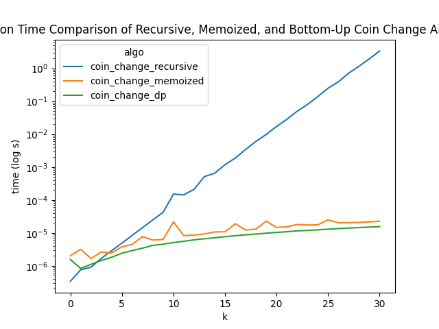

## Results
Initially, the recursive algorithm performed better than the other algorithms, because it had no memory to store. However, once the amount started to increase, the other algorithms performed much better. The gap between the recursive algorithm and the other two became more apparent as the amount increased, as it had more options to try with no memory to rely on. 

